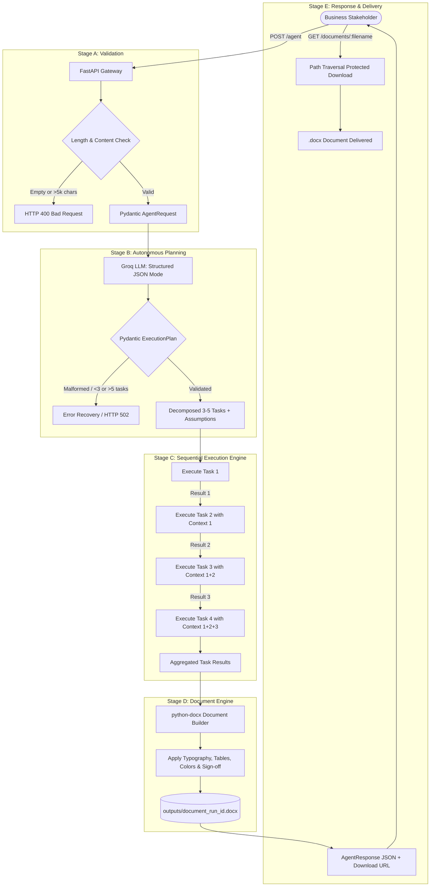

# Autonomous Document Agent 🤖📄

A robust, production-grade autonomous AI document generation agent built with **Python 3.11+**, **FastAPI**, **Pydantic v2**, **Groq (OpenAI-compatible client)**, and **`python-docx`**. 

The system accepts a natural-language business request, autonomously synthesizes a structured 3–5 task execution plan, executes tasks sequentially with cross-step contextual chaining, and compiles an executive Microsoft Word (`.docx`) deliverable.

---

## Architecture & Autonomous Execution Flow



---

## Key Features

1. **Autonomous Multi-Step Planning**: Dynamically decomposes ambiguous business prompts into 3 to 5 discrete, ordered tasks with explicit planning assumptions.
2. **Context-Chained Sequential Execution**: Later tasks receive the full history and deliverables of preceding tasks, ensuring cross-section coherence.
3. **Executive Document Styling**: Generates formatted Word documents featuring:
   - Deep Navy (`#1E3A8A`) and Slate Blue (`#2563EB`) executive color accents.
   - 1-inch margins and clean paragraph typography (`Calibri`).
   - Callout box containing the original user prompt.
   - Formatted execution plan table with shaded header cells.
   - Detailed task sections parsing markdown headers and bullet points.
   - Strategic recommendations, risk governance, and formal sign-off tables.
4. **Resilient Failure Handling**:
   - Bounded exponential backoff retry for transient network/rate limits.
   - Partial failure isolation (a failed task does not crash the server and is marked in the document).
   - Strict path traversal prevention on `/documents/{filename}`.
5. **100% Offline Testability**: Complete Pytest test suite with offline LLM mocking requiring zero API credits or network access.

---

## Project Structure

```text
autonomous-agent-challenge/
├── main.py              # FastAPI server, LLM pipeline, and Word doc generator
├── requirements.txt     # Locked production and testing dependencies
├── .env.example         # Environment variable template
├── .env                 # Local environment configuration (git-ignored)
├── .gitignore           # Git ignore rules for virtualenv, docx, and cache
├── README.md            # System architecture, setup guide, and documentation
├── outputs/             # Generated Word documents directory
│   ├── .gitkeep
│   ├── document_test_a_standard_business_proposal.docx
│   └── document_test_b_complex_college_ai_assistant.docx
└── tests/
    └── test_agent.py    # Automated test suite (13 tests covering all specs)
```

---

## Installation & Setup (Windows PowerShell)

### Prerequisites
- Python 3.11 or higher (Python 3.14+ supported)
- Windows PowerShell / Terminal
- Free Groq API Key from [console.groq.com/keys](https://console.groq.com/keys)

### Step 1: Clone / Navigate to Project Directory
```powershell
cd D:\fluidAI\autonomous-agent-challenge
```

### Step 2: Set Up Virtual Environment
```powershell
# Create virtual environment (if not already present)
python -m venv .venv

# Activate virtual environment
.\.venv\Scripts\Activate.ps1
```

### Step 3: Install Dependencies
```powershell
pip install -r requirements.txt
```

### Step 4: Configure Environment Variables
Copy `.env.example` to `.env`:
```powershell
Copy-Item .env.example .env
```
Edit `.env` and supply your Groq API key:
```env
GROQ_API_KEY=gsk_your_actual_groq_api_key_here
GROQ_BASE_URL=https://api.groq.com/openai/v1
GROQ_MODEL=llama-3.3-70b-versatile
LLM_TEMPERATURE=0.2
LLM_MAX_RETRIES=3
OUTPUT_DIR=outputs
HOST=127.0.0.1
PORT=8000
```

---

## Running the Server

Start the FastAPI application with Uvicorn:
```powershell
# From the project root with .venv activated:
python -m uvicorn main:app --host 127.0.0.1 --port 8000 --reload
```

Server will start on: `http://127.0.0.1:8000`

---

## Interactive Swagger UI Documentation

FastAPI provides interactive OpenAPI documentation:
- **Swagger UI**: [http://127.0.0.1:8000/docs](http://127.0.0.1:8000/docs)
- **ReDoc**: [http://127.0.0.1:8000/redoc](http://127.0.0.1:8000/redoc)

You can test all endpoints (`GET /health`, `POST /agent`, `GET /documents/{filename}`) directly in the browser interface.

---

## API Endpoints

### 1. Health Check
`GET /health`

**Response (`200 OK`)**:
```json
{
  "status": "healthy",
  "service": "Autonomous Document Agent",
  "model": "llama-3.3-70b-versatile",
  "base_url": "https://api.groq.com/openai/v1",
  "timestamp": "2026-10-22T11:00:00.000000+00:00"
}
```

---

### 2. Run Autonomous Document Agent
`POST /agent`

**Request Body**:
```json
{
  "request": "Create a business proposal for launching an AI-powered customer support chatbot for a small e-commerce company."
}
```

**Example Response (`200 OK`)**:
```json
{
  "run_id": "8f88ce14-bc42-4f36-9e67-d86bfe2bfa4e",
  "status": "success",
  "plan": {
    "document_title": "AI-Powered Customer Support Chatbot Commercial Proposal",
    "document_type": "Business Proposal & Feasibility Plan",
    "assumptions": [
      "Target client is an active Indian D2C e-commerce retailer processing 5,000 orders/month",
      "Implementation horizon is strictly 6 weeks",
      "All cost estimates in INR are modeled illustrative estimates"
    ],
    "tasks": [
      {
        "title": "Business Objectives & Core Chatbot Architecture",
        "objective": "Define customer support automation scope and essential functional capabilities."
      },
      {
        "title": "Six-Week Implementation Roadmap",
        "objective": "Establish weekly phased milestones across API integration and pilot launch."
      },
      {
        "title": "Illustrative Budget Breakdown in INR",
        "objective": "Itemize estimated infrastructure and deployment costs in INR."
      },
      {
        "title": "Risk Governance and Success Metrics",
        "objective": "Establish failovers, human escalation triggers, and target CSAT benchmarks."
      }
    ]
  },
  "tasks": [
    {
      "task_id": 1,
      "title": "Business Objectives & Core Chatbot Architecture",
      "objective": "Define customer support automation scope and essential functional capabilities.",
      "status": "completed",
      "output": "### 1.1 Strategic Objectives\n- Deflect 65%+ of Tier-1 Inquiries..."
    }
  ],
  "summary": "Generated 'AI-Powered Customer Support Chatbot Commercial Proposal' (Business Proposal & Feasibility Plan). Completed 4/4 planned tasks covering: Business Objectives & Core Chatbot Architecture, Six-Week Implementation Roadmap, Illustrative Budget Breakdown in INR, Risk Governance and Success Metrics. Baseline assumptions established: Target client is an active Indian D2C e-commerce retailer processing 5,000 orders/month; Implementation horizon is strictly 6 weeks; All cost estimates in INR are modeled illustrative estimates. Comprehensive document formatted and ready for download.",
  "document_url": "/documents/document_8f88ce14-bc42-4f36-9e67-d86bfe2bfa4e.docx",
  "filename": "document_8f88ce14-bc42-4f36-9e67-d86bfe2bfa4e.docx",
  "created_at": "2026-10-22T11:00:15.123456+00:00"
}
```

---

### 3. Download Generated Document
`GET /documents/{filename}`

- **Example**: `GET /documents/document_test_a_standard_business_proposal.docx`
- Returns binary file stream (`application/vnd.openxmlformats-officedocument.wordprocessingml.document`).
- **Path Traversal Protection**: Filenames containing directory traversal characters (`..`, `/`, `\`) or invalid extensions are rejected with `HTTP 400 Bad Request`. Non-existent files return `HTTP 404 Not Found`.

---

## Test Inputs & Demonstrations

### Scenario A: Standard Business Request
> **Request Prompt**:
> *"Create a business proposal for launching an AI-powered customer support chatbot for a small e-commerce company. Include objectives, core features, a six-week implementation timeline, estimated budget assumptions in INR, risks, success metrics, and recommendations. Clearly label illustrative cost estimates."*

**PowerShell Execution**:
```powershell
$body = @{
    request = "Create a business proposal for launching an AI-powered customer support chatbot for a small e-commerce company. Include objectives, core features, a six-week implementation timeline, estimated budget assumptions in INR, risks, success metrics, and recommendations. Clearly label illustrative cost estimates."
} | ConvertTo-Json

Invoke-RestMethod -Uri "http://127.0.0.1:8000/agent" -Method Post -ContentType "application/json" -Body $body
```

**Pre-Generated Deliverable**:
- File: `outputs/document_test_a_standard_business_proposal.docx`
- Download Endpoint: `http://127.0.0.1:8000/documents/document_test_a_standard_business_proposal.docx`

---

### Scenario B: Complex Business Request (College AI Assistant)
> **Request Prompt**:
> *"Prepare a project plan for a college that wants to deploy an AI assistant for 5,000 students within eight weeks. The budget is limited, student data is sensitive, and the college has not decided which LMS or AI model to use. Include architecture options, a recommended approach, a phased timeline, team responsibilities, budget assumptions in INR, privacy risks, testing, deployment, and fallback plans. Identify missing information and make reasonable assumptions rather than blocking the task."*

**PowerShell Execution**:
```powershell
$body = @{
    request = "Prepare a project plan for a college that wants to deploy an AI assistant for 5,000 students within eight weeks. The budget is limited, student data is sensitive, and the college has not decided which LMS or AI model to use. Include architecture options, a recommended approach, a phased timeline, team responsibilities, budget assumptions in INR, privacy risks, testing, deployment, and fallback plans. Identify missing information and make reasonable assumptions rather than blocking the task."
} | ConvertTo-Json

Invoke-RestMethod -Uri "http://127.0.0.1:8000/agent" -Method Post -ContentType "application/json" -Body $body
```

**Pre-Generated Deliverable**:
- File: `outputs/document_test_b_complex_college_ai_assistant.docx`
- Download Endpoint: `http://127.0.0.1:8000/documents/document_test_b_complex_college_ai_assistant.docx`

---

## Running Automated Tests

The automated test suite runs 100% offline using `unittest.mock` to simulate LLM responses, ensuring instant execution without consuming API tokens.

```powershell
# Run all tests with verbose output
.\.venv\Scripts\pytest.exe -v
```

### Test Coverage Summary:
| Test Name | Verification Target |
|:---|:---|
| `test_health_check` | Validates `GET /health` returns 200 and healthy metadata |
| `test_empty_request_rejection` | Verifies rejection of empty strings & whitespace with HTTP 400 |
| `test_excessively_long_request_rejection` | Verifies rejection of >5,000 char requests with HTTP 400 |
| `test_valid_plan_parsing` | Verifies Pydantic parsing of 3–5 task execution plans |
| `test_valid_plan_parsing_with_markdown_fences` | Verifies stripping of \`\`\`json markdown blocks |
| `test_malformed_plan_rejection_invalid_json` | Validates rejection of unparseable model responses |
| `test_malformed_plan_rejection_too_few_tasks` | Enforces minimum 3 tasks threshold |
| `test_malformed_plan_rejection_too_many_tasks` | Enforces maximum 5 tasks threshold |
| `test_document_creation_and_file_existence` | Verifies `.docx` file generation, typography, and tables |
| `test_invalid_document_filename_rejection` | Validates path traversal & non-docx extension blocking |
| `test_missing_document_returns_404` | Verifies HTTP 404 for non-existent documents |
| `test_full_agent_workflow_success_mocked` | Tests full end-to-end multi-step agent pipeline |
| `test_partial_failure_handling_mocked` | Verifies task failure isolation and run status reporting |

---

## Engineering Improvement: Multi-Step Planning & Architecture

### Why Multi-Step Planning?
In single-prompt document generation, LLMs suffer from "context dilation" and loss of structural coherence:
1. **Task Decomposition**: Breaking a multi-faceted business request into discrete tasks (e.g., Scope Definition -> Technical Architecture -> Budgeting -> Risk Management) reduces cognitive load on the LLM, producing significantly deeper analysis in each section.
2. **Context Chaining & Coherence**: The executor passes the outputs of all earlier steps into each subsequent task prompt. For example, when Task 3 calculates the budget in INR, it directly references the specific architecture components chosen in Task 2.
3. **Traceability & Visibility**: Business stakeholders can review the exact plan, examine intermediate task outputs, and verify execution milestones before opening the final Word document.
4. **Adaptability without Hardcoding**: Rather than using a static template, the agent dynamically devises a bespoke sequence of tasks tailored to the domain, constraints, and requested format.

### Design Trade-offs:
- **Sequential vs. Parallel Execution**: Sequential execution increases total generation latency (N sequential LLM calls) compared to parallel dispatch. However, sequential execution is mandatory for true contextual chaining, where budget and risk assessments depend on prior architectural decisions.
- **In-Memory State vs. Database**: For this 60-minute challenge, runs and state are maintained per request without introducing unnecessary external database dependencies (e.g. PostgreSQL or Redis), ensuring the project remains fully runnable and easily explainable.

---

## Known Limitations & Future Roadmap

1. **Async Polling / Webhook Callbacks**: For extremely long documents with 5 detailed tasks, LLM generation can take 20–40 seconds. A production evolution would return HTTP 202 Accepted with a task polling or WebSocket/Webhook notification mechanism.
2. **Dynamic Chart Generation**: Future versions could integrate `matplotlib` to insert generated financial burn-down or timeline Gantt charts directly into the Word document.
3. **Interactive Human-in-the-Loop Approval**: Allow a user to review and tweak the generated `ExecutionPlan` JSON before initiating sequential task execution.
